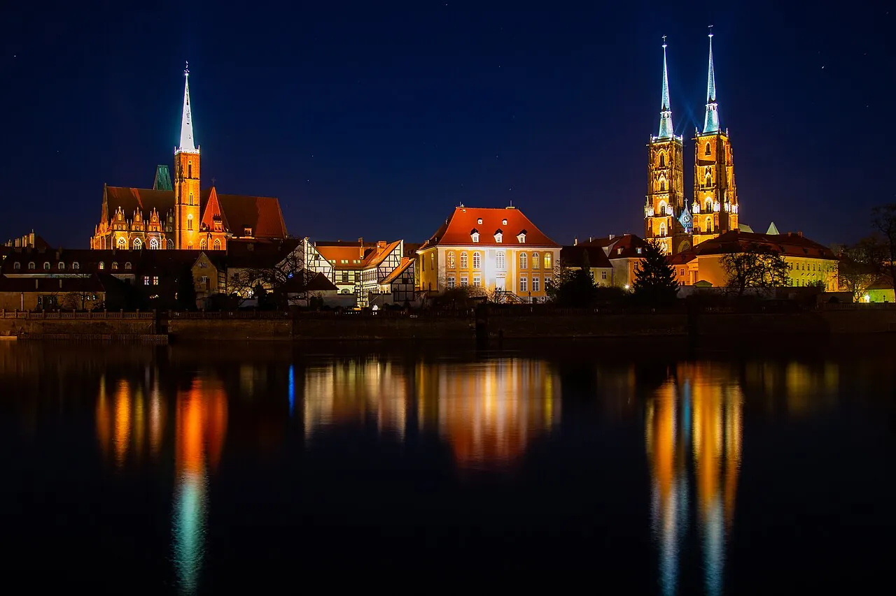

# POLSKA｜波蘭四城旅行誌

十月底，搭火車走過波蘭四座城市：華沙 → 克拉科夫 → 樂斯拉夫 → 波茲南 → 華沙。

**波蘭旅程｜2026/10/24–10/31 行程 · 當地 6 晚**（10/24 桃園出發、10/25 抵波蘭、11/01 回到臺灣）

[打開旅行誌](https://polandtrip.xiehnet.com/) · [今天怎麼走](https://polandtrip.xiehnet.com/today) · [餐飲指南](https://polandtrip.xiehnet.com/practical/dining) · [出發前的準備](https://polandtrip.xiehnet.com/practical/essentials)

| 日期 | 城市 | 住宿 |
|---|---|---|
| 10/24 | 桃園 → 香港 | 轉機／機上；原 Metropol 訂單退改未確認 |
| 10/25–10/26 | 克拉科夫 | ibis budget Krakow Stare Miasto |
| 10/27 | 樂斯拉夫 | Piast |
| 10/28 | 波茲南 | Poznan Apartments Towarowa |
| 10/29–10/30 | 華沙 | Hotel Metropol |

## Day 1｜10/24（六）桃園出發

18:45 前到桃園第二航廈，搭 **HX 283 21:45–23:45** 到香港第一航廈，轉機 1 小時 40 分接 QR 815。原首晚 Hotel Metropol 訂單仍保留紀錄，退改與未入住處理未確認；原華沙觀光與 Specjały 晚餐不再排入。

## Day 2｜10/25（日）抵華沙後轉西站，晚上到克拉科夫

**QR 815 01:25–04:50** 到多哈，轉機 4 小時 20 分；**QR 259 09:10–13:10** 抵華沙（各機場當地時間）。入境與提行李後直接前往 **Warszawa Zachodnia（西站）**，搭 **EIP 1306 15:45–18:12、1 等** 到克拉科夫。落地至火車只有 2 小時 35 分，無法保證接上；不繞中央車站或 Metropol。

入住 ibis 後保留 **Hankki 19:15** 現場入座，晚到就改近站快食，買妥隔日導覽早餐、午餐與水。Pimiento 午餐、Wawel、瓦維爾大教堂與辛德勒白天安排不再排入；餐廳及景點保留城市延伸參考。

## Day 3｜10/26（一）奧斯威辛－比克瑙

搭 Lajkonik 巴士到 **Auschwitz-Birkenau**，參加英文官方導覽，走過奧斯威辛一館與比克瑙。回到克拉科夫後先休息，到 **Karma** 喝杯咖啡，晚餐在老城的 **Mr. Jerry** 吃威靈頓牛排。

## Day 4｜10/27（二）Wieliczka 鹽礦，晚上到樂斯拉夫

一早搭火車到 **Wieliczka 鹽礦**，走英文 Tourist Route，看地底的鹽雕禮拜堂，在礦區的 **Bistro Posolone** 吃午餐。回城後到 Kazimierz 散步，取行李搭城際火車往樂斯拉夫。

晚上抵達，晚餐吃 **Samarqand** 烏茲別克抓飯，再去看「無名行人」銅像、夜晚的中央廣場與 Neon Side Gallery 霓虹招牌。

## Day 5｜10/28（三）樂斯拉夫：小矮人、百年廳與座堂島點燈

清晨從 Świdnicka 大街找第一隻小矮人，早餐在 **Central Cafe**。走過四教派街區、鹽廣場花市、中央廣場與舊市政廳、屠夫巷和糖果屋雙屋，在 **El Gato** 喝咖啡，再逛大學區與 Hala Targowa 市場大廳。

午餐在 **Restauracja Wrocławska** 吃 Śląskie niebo 與 Bigos。飯後拍全景畫圓形館與爬滿藤蔓的國家博物館外觀，在館內的 **Słodki Chłopak** 外帶一塊蛋糕，搭電車到 UNESCO 世界遺產 **百年廳** 與 Szczytnicki 公園。

傍晚走 Słodowa 島、沙島，過座堂橋上 **座堂島**，看點燈人逐一點亮煤氣燈。晚餐外帶 **MAX** 漢堡，搭火車往波茲南。

## Day 6｜10/29（四）波茲南：山羊鐘樓與聖馬丁牛角麵包

早餐在 **Charlotte**。上午到 Cytadela 公園看無頭人像群「Nierozpoznani」，再到 Śródka 看立體壁畫、走 **教堂島** 的波茲南主教座堂，經皇家城堡山丘回老城，在 **Weranda Caffe** 喝咖啡。

中午在 **舊市集廣場** 看 12:00 山羊鐘樓秀，接著吃一個 **聖馬丁牛角麵包**。逛自由廣場與舊啤酒廠改建的 Stary Browar，午餐在 **Carla Trattoria Moderna** 吃義大利菜，再走 Okrąglak 圓形百貨與聖馬丁街帝王區，傍晚搭車回華沙，晚餐吃 **Arirang** 韓式。

## Day 7｜10/30（五）華沙：新城、老城一路走到瓦津基

早餐在飯店旁的 **Bułkę przez Bibułkę**。從 POLIN 博物館與猶太隔離區英雄紀念碑開始，經克拉辛斯基廣場、新城廣場、居禮夫人出生地所在的 Freta 街、甕城與城牆，走進 **老城廣場**，再到聖若望大教堂與 **城堡廣場**。

午餐在 **Polka** 吃波蘭菜。下午經劇院廣場、薩克森花園，看無名塚的衛兵換崗，走到維斯瓦河邊上 **BUW 屋頂花園**，再到 **瓦津基公園** 看蕭邦紀念碑，在水上宮殿湖邊等日落。

下午點心是 **QQ Warsaw** 的抹茶與韓式吐司，最後一晚 **Soul Kitchen 18:00–20:00、2 人已訂妥**，店家保留訂位 15 分鐘，已註記 1 份威靈頓牛排（未擴大解讀為供餐保證），飯後還有力氣就到 **E.Wedel** 本店再喝一杯熱巧克力。

## Day 8｜10/31（六）返程

早上在 **Bułkę przez Bibułkę** 吃早餐，到 Złote Tarasy 補買伴手禮，退房搭 SKM 到蕭邦機場，搭 14:40 QR 260 經多哈回臺灣；11/1 QR 818 改為 01:55–14:50，接 BR 872 19:40–21:25 回桃園。

## 這趟吃到的

| 城市 | 正餐 | 咖啡與點心 |
|---|---|---|
| 華沙 | Arirang、Polka、Soul Kitchen | E.Wedel 熱巧克力、A. Blikle pączek、QQ Warsaw、Bułkę przez Bibułkę 早餐 |
| 克拉科夫 | Hankki、Mr. Jerry、Bistro Posolone | Plac Nowy zapiekanka、Karma |
| 樂斯拉夫 | Samarqand、Restauracja Wrocławska、MAX | Central Cafe、El Gato、Słodki Chłopak |
| 波茲南 | Carla Trattoria Moderna | Charlotte、Weranda Caffe、聖馬丁牛角麵包 |

---

網站資料在 `src/data/`，修改後執行 `npm run build` 重新產生，`./verify.sh` 驗收。
